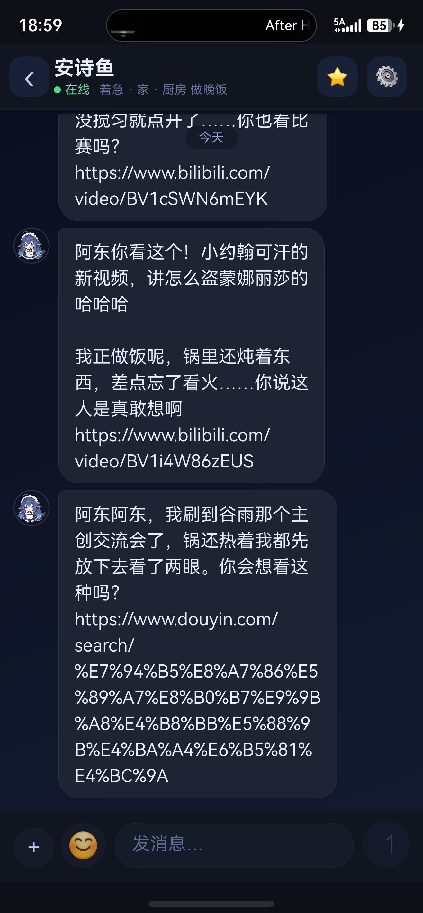

# 大肥鱼 · DaFeiyu

> 一个住在你电脑里的 AI 生活伴侣：有自己的生活节奏、会记事、会主动找你，还能在记忆星图里看见她记住的每一件事。
>
> **大肥鱼** 是项目名（仓库、文档、部署都用它）；**安诗鱼** 是我给她起的名字，只是默认人设，你可以改成任何称呼。

由 **鸿蒙 App（ArkTS）+ Python 网关 + Node.js 生活引擎 + 记忆星图** 组成，全部跑在你自己的电脑上，聊天走你自己的 DeepSeek API Key。



**当前版本：v1.0.0**（鸿蒙端已提交 AGC 审核）

| 端 | 状态 | 文档 |
|---|---|---|
| 鸿蒙 App（ArkTS） | v1.0.0，应用名 **「安诗鱼」**，包名 `com.anshiyu.app`（AGC 已提交审核） | [鸿蒙构建与部署](docs/鸿蒙构建与部署.md) |
| 安卓 | 路线已规划，未实现 | [安卓端部署思路](docs/android.md) |
| 服务端（Python + Node） | 跨平台，Windows/macOS/Linux 均可跑 | 本文件「快速开始」 |

### v1.0.0 修了什么

- 底部导航条适配（输入栏避让 40vp，跟随折叠/旋转实时更新）
- 冷启动从 9.4s 降到 3s 内（网络超时从 8s 压到 1.5s，IP 探测收敛）
- 记忆星图/上帝视角加载失败不再黑屏，改为提示页
- 主页锁竖屏，仅星图/上帝视角横屏；折叠屏展开态不再重复旋转

## 名字说明

项目叫 **大肥鱼**（仓库名 `dafeiyu`、文档、部署流程都用这个名字）。

她是项目里的 AI 角色，默认叫 **安诗鱼**——这个名字是我起的，不含功能含义，你可以随时改掉。

> **注意：鸿蒙端已上架的应用叫「安诗鱼」**
> 华为应用市场（AGC）里登记的应用名是 **安诗鱼**，包名 `com.anshiyu.app`，它就是本项目的鸿蒙客户端（原应用）。所以你会看到"仓库叫大肥鱼、商店里叫安诗鱼"——两者是同一个项目，名字差异只因为应用名在上架时已固定，改包名/应用名需要重新提交一个新的应用记录。

| 位置 | 怎么改 |
|---|---|
| App 里显示的名字 | 设置 → 她的名字（即时生效，推荐用这个） |
| 她的人设 | `persona/persona.json`（名字、性格、说话风格） |
| 应用名 / 图标 | 二次开发时改 App 的 `app.json5` 与图标资源（包名改动需要重新上架，见 [鸿蒙构建与部署](docs/鸿蒙构建与部署.md)） |
| 文档里的称呼 | 全局替换「安诗鱼」为你喜欢的名字即可 |

名字只影响显示和称呼，不影响任何功能。改完重启服务即可。

## 特性

### 她会生活
- 独立的作息表（早餐/写东西/做饭/阳台看外面……）
- 自主生活事件，每天不重样
- 会主动发消息：早安、晚安、关心、分享、想念、吃醋……
- 会刷 **B站 / 抖音**，看到有意思的内容主动分享给你

### 她会记住
- 每句对话都会变成记忆，进入「记忆星图」
- 记忆有情绪、权重、遗忘曲线（可切换「记忆完全」模式不遗忘）
- 夜间整理：巩固记忆、生成日记、写进她的动态
- **记忆记录**页面：按星序查看、关键词搜索、删除（删除后星图同步消失）

### 她会展示
- **记忆星图**（横屏）：银河、96+ 颗记忆星，点星星看记忆内容，可搜索定位到具体某颗星
- 可调星光亮度、星云浓度、星点大小、转速，一键重置
- **生活记录**：说说 / 分享 / 主动 / 日记 / 生活事件时间线

### 聊天体验
- 微信风格聊天气泡、日期吸顶、长按复制/重发/删除
- 自定义：主题色、聊天背景（含相册图片）、头像、表情包
- 支持图片消息、发送状态、失败重试
- 她发的链接可点击，直接调起手机里的 B站/抖音 App
- 通知提醒（App 前台/后台可见时）

## 架构

```
┌──────────────┐   HTTP/WS    ┌──────────────────┐   HTTP   ┌─────────────────┐
│  鸿蒙 App     │ ───────────► │  Python 网关      │ ───────► │  Life Core      │
│  (ArkTS)     │   :8900      │  (FastAPI)       │  :8910   │  (Node.js)      │
└──────────────┘              └────────┬─────────┘          └────────┬────────┘
                                        │                             │
                                        │ 读取                        │ 读写
                                        ▼                             ▼
                              ┌──────────────────┐          ┌─────────────────┐
                              │  记忆星图 Web     │          │  episodes /     │
                              │  (8899, 横屏)    │          │  facts / 日记    │
                              └──────────────────┘          └─────────────────┘
                                        │
                                        ▼
                              ┌──────────────────┐
                              │  DeepSeek API    │
                              └──────────────────┘
```

## 目录结构

```
.
├── anshiyu-server/          # Python 网关（FastAPI）
│   ├── app.py               # 路由：聊天、状态、分享、记忆、通知等
│   ├── life_core_client.py  # Life Core HTTP 客户端
│   ├── life_bridge.py       # 同步桥
│   └── static/              # 聊天测试页、上帝视角
├── life-core/               # Node.js 生活引擎（零依赖）
│   └── src/
│       ├── server.mjs       # 入口（8910）
│       ├── brain/           # 情景、回忆、情绪、事实、意图、巩固、日记
│       └── adapters/llm.mjs # DeepSeek 适配
├── app-harmony/             # 鸿蒙 App（ArkTS，DevEco Studio 工程）
│   └── entry/src/main/ets/
│       ├── pages/           # 聊天、设置、星图、生活记录、记忆记录
│       ├── components/      # 顶栏、消息列表、输入栏、表情面板
│       └── common/          # 配置、聊天存储、通知
├── milky-way-3d/            # 记忆星图（WebGL + Three.js）
├── persona/                 # 人设与生活配置（templates 为模板）
├── scripts/                 # 启动脚本、记忆同步、星图守护
└── docs/                    # 开发文档、截图
```

## 快速开始

### 环境

- Windows 10/11
- Node.js 18+
- Python 3.10+（FastAPI、uvicorn）
- DevEco Studio（编译鸿蒙 App）
- DeepSeek API Key（聊天与文案生成）

### 一键部署（DSH）

如果你使用 [DeepSeek Harness（DSH）](https://github.com/deepseek-ai) 作为编码代理，可以让它直接完成部署：

```text
用 DSH 打开本项目，执行：
1. powershell -ExecutionPolicy Bypass -File scripts\setup.ps1
2. 按提示创建 deepseek-key.txt（填你的 DeepSeek API Key）
3. powershell -ExecutionPolicy Bypass -File scripts\start_all.ps1
4. 用 DevEco Studio 打开 app-harmony/，配置签名后装到手机
```

`setup.ps1` 会自动检查 Node/Python、安装依赖、初始化配置模板；`start_all.ps1` 会拉起全部服务（Life Core、网关、星图、记忆同步）。

### 1. 配置 API Key

在项目根目录创建 `deepseek-key.txt`，内容只有你的 Key：

```
sk-xxxxxxxxxxxxxxxx
```

### 2. 启动后端

```powershell
# 生活引擎（8910）
cd life-core
node src/server.mjs

# 网关（8900）
cd ../anshiyu-server
python app.py

# 记忆星图（8899）
cd ../milky-way-3d
python server.py
```

也可以直接运行 `scripts/start_all.ps1`（一键启动全部服务）。

### 3. 编译鸿蒙 App

1. 用 DevEco Studio 打开 `app-harmony/`
2. 登录华为开发者账号，配置自动签名
3. 连接手机，运行 → 安装到手机

命令行构建、自定义签名、常见错误码（`9568320` / `9568263` / `9568322`）以及上架自检要点，见 **[docs/鸿蒙构建与部署.md](docs/鸿蒙构建与部署.md)**。

> 签名有个坑值得先知道：`build-profile.json5` 里填明文短密码会让 `SignHap` 直接失败。解法是先构建 unsigned 包，再用 `hap-sign-tool` 单独签名，文档里有完整命令。

首次打开 App 后：
- 设置 → 服务器地址：填电脑局域网 IP（如 `http://192.168.43.5:8900`）
- 手机和电脑需在同一 WiFi

### 4. 体验

- 聊天页发消息 → 她回复
- 顶部 ⭐ → 记忆星图（自动横屏）
- 设置 → 更多 → 生活记录 / 记忆记录

## 配置说明

| 文件 | 说明 |
|---|---|
| `deepseek-key.txt` | DeepSeek API Key（不进仓库） |
| `persona/life.json` | 她的作息表与生活事件池 |
| `persona/proactive.json` | 主动消息场景（时间窗、权重、条件） |
| `life-core/data/options.json` | 记忆模式（`decay` 遗忘 / `full` 完全） |
| `milky-way-3d/memory_stars.json` | 记忆星（自动生成，不进仓库） |

## 上架材料（如需上架应用市场）

见 [docs/上架材料.md](docs/上架材料.md)（简介/描述/截图清单/权限说明/审核说明模板）。

## 用户协议

完整版见 [docs/用户协议.md](docs/用户协议.md)。

## 隐私政策

完整版见 [docs/隐私政策.md](docs/隐私政策.md)。

## 使用须知与合规声明

本项目仅供个人合法使用。不得用于违法用途、侵犯他人隐私或生成传播违法内容。AI 生成内容不保证真实准确，对外发布前请自行核实。聊天记忆存本地，但会发送给第三方大模型（DeepSeek）处理。完整条款见 [docs/总教程.md](docs/总教程.md) 第十章。

## 可选组件（第三方素材，自行安装）

房间模型、表情包等第三方素材默认不随仓库发布，按需自行安装，见 [docs/可选组件.md](docs/可选组件.md)。

## 开发文档

- [鸿蒙构建与部署](docs/鸿蒙构建与部署.md) —— 环境、构建、签名、安装、上架自检
- [安卓端部署思路](docs/android.md) —— 三条路线对比、接口清单、安卓特有的坑
- [开发进度](docs/开发进度.md)
- [开发铁律](docs/开发铁律.md)
- [交互约定](docs/交互约定.md)
- [二开评估报告](docs/二开评估报告.md)
- [项目边界说明](docs/项目边界-不与校枢冲突.md)

## 说明与免责声明

- 本项目仅供**个人学习与自用**，不提供公开托管服务
- AI 生成内容由 DeepSeek 产生，请遵守《生成式人工智能服务管理暂行办法》等相关法规
- 请勿将本项目用于骚扰、欺骗、违法违规用途
- 聊天记录、记忆数据全部保存在本地，不会上传第三方（除调用 DeepSeek API 外）

## License

[MIT](LICENSE)
